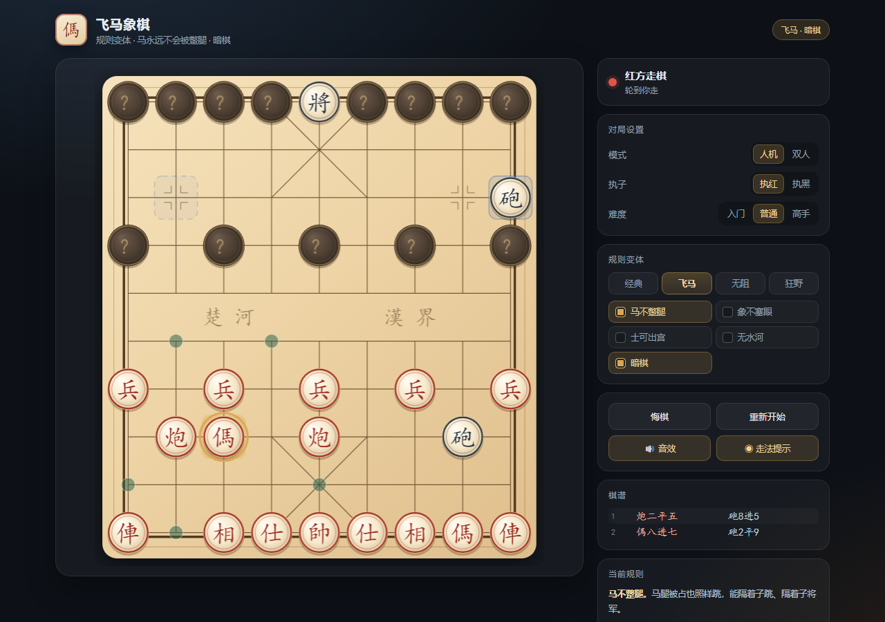

# 飞马象棋 · 规则实验室

一个可以直接玩的中国象棋，**规则可以拆开重组**：马不蹩腿、象不塞眼、士可出宫、无水河，
外加一个**暗棋（迷雾）**模式。双击 `index.html` 就能开局，不需要装任何东西、不需要起服务器
（纯静态页面，无外部依赖、无网络请求）。


---

## 四套预设 + 五个开关

规则面板里可以点预设，也可以单独勾开关（勾出非预设的组合会自动变成「自定义」）。

| 预设 | 马不蹩腿 | 象不塞眼 | 士可出宫 | 无水河 |
|---|:--:|:--:|:--:|:--:|
| **经典** | – | – | – | – |
| **飞马**（默认） | ✅ | – | – | – |
| **无阻** | ✅ | ✅ | ✅ | – |
| **狂野** | ✅ | – | ✅ | ✅ |

「暗棋」是独立开关，可以叠在任意预设上（双人同屏时不可用）。

### 四个规则开关

| 开关 | 效果 |
|---|---|
| 马不蹩腿 | 马腿被占也照样跳，能隔着子跳、隔着子将军 |
| 象不塞眼 | 象眼的子挡不住飞象，象能隔着子看守本方半场 |
| 士可出宫 | 仕/士可以走出九宫，沿斜线满盘跑 |
| 无水河 | 没有河界：兵从一开始就能横走，象也能过河参战 |

每拆掉一条限制，开局的合法着法就多一批（`perft(1)`）：

| 经典 | 飞马 | 无阻 | 狂野 |
|:--:|:--:|:--:|:--:|
| 44 | 46 | 48 | 56 |


左边是本作默认的「飞马」，右边是「经典」，同一匹马差一步——差的正是被自家象堵住马腿的那一步。

**其余规则在任何预设下都不变**，并且有测试盯着：炮必须翻山才能吃、白脸将、被牵制的子不能
离线、将不出九宫、被将军必须应将、将死判负、困毙也判负。

### 暗棋（迷雾）



- 对方**没动过的子看不见**，显示成「？」的棋背
- 只要动过一次就**永久现形**（走到哪，亮到哪）
- **将/帅始终可见**——不然连自己有没有被将军都无法判断
- 可以**走进迷雾吃子**：落点上有暗子就直接吃掉，吃掉才知道那是什么
- 暗子照样挡路：你的车看不穿的格子，也走不过去
- 电脑同样看不见你的暗子

最后一条是重点。公平的实现不能只是「挡住玩家的眼睛」，所以 AI 走的是**不完全信息搜索**：
先按已知信息随机采样 6 个可能的局面（己方棋子、已现形的敌子不动，失踪的敌子按兵种数量守恒
随机撒回空白格，撒放时尽量遵守该兵种的活动范围），对每个采样局面正常搜索，再按平均分选招。
选出来的招最后还要回到真实棋盘做一次合法性过滤——它以为能穿过去的格子，可能真的站着人。

## 怎么玩

- 点自己的棋子 → 棋盘上标出所有合法落点（绿点＝空格，红圈＝可吃）→ 点落点落子
- 按 `Esc` 取消选择，按 `U` 悔棋
- 右侧面板：人机/双人、执红执黑、三档难度、规则预设与开关、悔棋、重开、音效、走法提示
- 棋谱用标准中文记法（`炮二平五`、`馬8进6`、`前炮平九`），红黑方各自的列号方向、
  同一列双子用「前/中/后」，都按规则处理了

## 引擎

- 局面用 90 格数组表示，棋子编码成 `kind | color << 3` 的小整数
- 着法用整数 `from << 7 | to` 打包，搜索里只做 make/unmake，不复制棋盘
- 搜索：negamax + alpha-beta + MVV-LVA 排序 + 迭代加深 + 时间上限，
  超时抛异常回退到上一层完整结果
- 评估：子力价值（俥 900 / 炮 450 / 傌 400 / 仕相 200 / 兵 100）加位置分
- 暗棋：PIMC（采样 + 平均），6 个采样、深度比正常低 2 层
- 难度：入门 250ms、普通 700ms、高手 1200ms

**每条规则开关都同时作用于「走法生成」和「被攻击判定」**，两边共用一个 `rules` 对象。
这不是洁癖：如果生成器说这步能走、判定却说走完自己被将，就会产生「能走但走了算输」的矛盾局面。
马能隔着子将军，所以这个一致性问题在马身上第一次出现，之后每个开关都得照此办理。

## 测试

```bash
node test.js
```

64 项断言，覆盖规则、记谱、搜索、暗棋和四个预设。最核心的是 **perft**：
同一份走法生成器切到经典规则后，从开局起的三层节点数必须等于公开基准值
`44 / 1920 / 79666`。这个数字对上了，说明车马炮象士将的走法、将军判定、
白脸将、送将过滤全都没写错；四个预设的 perft(1) 分别是 `44 / 46 / 48 / 56`，
多出来的每一着都对应一条被拆掉的限制。

还专门测了：

- 马腿全堵死仍能走 8 个点，经典下 0 个点；马腿被挡也能隔子将军
- 塞象眼飞不过去 / 象眼无阻能飞过去；象过河前后
- 士出宫前后各 2 / 4 步
- 兵过河前后横走、兵在河界前也能横顶
- 四个预设下炮需炮架、白脸将、牵制、将不出九宫都不变
- 暗棋采样 200 次兵种数量守恒、己方与已现形棋子不动；`thinkFog` 每次都给出真实合法着法
- 四个预设各跑 60 步随机自对弈不崩

界面部分用 CDP 驱动真浏览器验证过（`tools/drive.js`）：预设切换、开关联动、暗棋吃子、
暗棋悔棋还原、双人模式自动关迷雾、将死浮层、窄屏布局。

## 文件

```
index.html          界面：Canvas 棋盘、交互、动画、音效、规则面板、暗棋渲染
engine.js           规则（4 个开关 + 4 个预设）+ 搜索引擎 + 暗棋采样 + 中文记谱
test.js             规则与引擎回归测试
screenshots/        截图
tools/drive.js      用 CDP 打开页面、跑一段脚本、截图（开发用）
tools/scenario-*.js 上面那些截图/回归用的页面脚本
```

`engine.js` 用 UMD 包了一层，浏览器里是 `window.Xiangqi`，Node 里 `require('./engine.js')`，
所以规则和 AI 都能脱离界面单独测。页面里还留了个 `window.XQ` 调试钩子
（`XQ.state` / `XQ.setRules` / `XQ.handleSquare`），方便在控制台里摆棋或做自动化。

## 已知边界

- 暗棋的 AI 是采样式近似，不是严格意义的不完全信息最优解；采样越多越强，也越慢
- 没有判「长将」「长捉」的循环规则，也没有 60 回合自然限着；重复局面不会自动判和
- 电脑在高手档思考时会占用主线程约 1 秒，期间界面不响应（有「思考中」提示）
- 棋盘固定红方在下，执黑时不翻转棋盘
