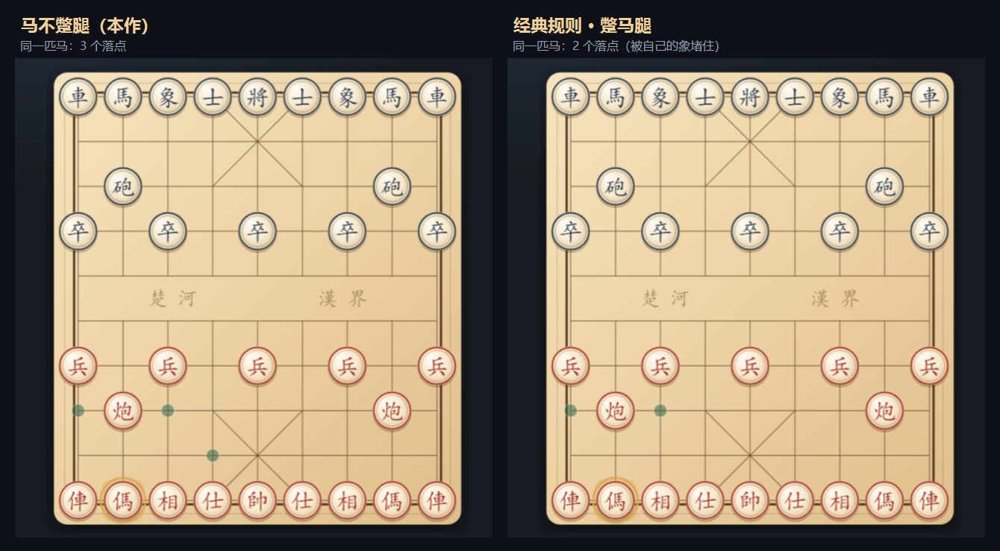

# 飞马象棋 · 马不蹩腿

一个可以直接玩的中国象棋，只改了一条规则：**马永远不被蹩马腿**。

双击 `index.html` 即可开局，不需要装任何东西、不需要起服务器（纯静态页面，无外部依赖、无网络请求）。


---

## 新规则

标准象棋里，马走「日」字时，紧挨着它的那一格（马腿）只要有子，这个方向就跳不过去。
**本作取消了这个限制**：只要落点在棋盘内、且不是自己的子，马就能跳过去，无论马腿被堵得多死。



同一匹马、同一个开局局面，左边是本作（3 个落点），右边是经典规则（2 个落点）——
差的那一步是被自家象堵住马腿的 `傌八进九`。点开侧栏的「经典蹩腿」可以随时切回去对照。

**其余规则全部保持标准：**

| 棋规 | 是否保留 |
|---|---|
| 象走田、塞象眼不能飞、象不过河 | ✅ 保留 |
| 仕/士走斜线一步、不出九宫 | ✅ 保留 |
| 炮平移同车、吃子必须隔一个炮架 | ✅ 保留 |
| 兵/卒向前一步，过河后才能横走 | ✅ 保留 |
| 两帅不能照面（白脸将） | ✅ 保留 |
| 被将军必须应将、不能送将 | ✅ 保留 |
| 将死判负、**困毙（无子可动）也判负** | ✅ 保留 |
| **马被蹩腿不能走** | ❌ **取消** |

最后一条连带着有个容易被忽略的地方：既然马能隔着子跳，那它也能隔着子**将军**。
所以判定「我这一步有没有被将军」时必须用和走子完全相同的规则，否则会出现
「这步能走，但走完算自己被将」的矛盾局面。引擎里 `genMoves` 和 `isAttacked`
共用同一个 `config.horseLegBlocked` 开关，就是为了保证两边永远一致。

## 怎么玩

- 点自己的棋子 → 棋盘上会标出所有合法落点（绿点＝空格，红圈＝可吃）→ 点落点落子
- 先点自己的子再点自己的另一个子可以换选，按 `Esc` 或点空白处取消
- 右侧面板：

| 控件 | 说明 |
|---|---|
| 模式 | 人机 / 双人（同一台电脑轮流走） |
| 执子 | 执红先手，或执黑让电脑先走 |
| 难度 | 入门 / 普通 / 高手（搜索深度 2 / 4 / 6，带时间上限） |
| 马腿 | 不蹩腿（本作）/ 经典蹩腿（对照用，切换会重开一局） |
| 悔棋 | 人机模式下一次退回两步（你一步、电脑一步）；也可以按 `U` |
| 音效 / 走法提示 | 落子音、走法圆点，都可以关 |

棋谱用标准中文记法（`炮二平五`、`馬8进6`、`前炮平九`），红黑方各自的列号方向、
同一列双子用「前/中/后」，都按规则处理了。

## 引擎

- 局面用 90 格数组表示，棋子编码成 `kind | color << 3` 的小整数
- 着法用整数 `from << 7 | to` 打包，搜索里只做 make/unmake，不复制棋盘
- 搜索：negamax + alpha-beta + MVV-LVA 排序 + 迭代加深 + 时间上限，
  超时抛异常回退到上一层完整结果
- 评估：子力价值（俥 900 / 炮 450 / 傌 400 / 仕相 200 / 兵 100）加位置分
  （兵过河加分、马喜中央等）
- 难度：入门 250ms、普通 700ms、高手 1200ms；实测（无头 Chrome）普通约 60ms / 7 万节点，
  高手跑满 1.2s / 210 万节点、搜到 5～6 层

棋力就是业余爱好者水平，够陪你下，但打不过正经引擎。

## 测试

```bash
node test.js
```

42 项断言，覆盖规则、记谱和搜索，其中最关键的一项是 **perft**：
同一份走法生成器切到经典规则后，从开局起的三层节点数必须等于公开基准值
`44 / 1920 / 79666`。这个数字对上了，说明车马炮象士将的走法、将军判定、
白脸将、送将过滤全都没写错；然后再切回变体，得到 `46 / 2096 / 91548`，
多出来的就是马不蹩腿带来的着法。

除了 perft，还专门测了：

- 把马四面围死，变体下仍能走 8 个点，经典下 0 个点
- 马腿被占时，变体下能隔子将军、经典下不算将军
- 象眼被塞照样不能飞、象不过河
- 炮有炮架能吃、无炮架不能吃
- 兵过河前不能横走，过河后可以
- 白脸将、被牵制的子不能离开防线
- 记谱（`炮二平五` / `傌八进七` / `前炮平九` …）
- 一步杀、白吃子、被将死时返回空
- 两局随机自对弈各 80 步不崩、评估值不炸

界面部分用 CDP 驱动真浏览器验证过（`tools/drive.js`）：选子、落子、电脑应招、
悔棋、双人、执黑、将死浮层、重新开始，以及窄屏布局。

## 文件

```
index.html          界面：Canvas 棋盘、交互、动画、音效、侧栏
engine.js           规则 + 搜索引擎 + 中文记谱（可在 Node 里直接 require）
test.js             规则与引擎回归测试
screenshots/        截图
tools/drive.js      用 CDP 打开页面、跑一段脚本、截图（开发用）
tools/scenario-*.js 上面那些截图/回归用的页面脚本
```

`engine.js` 用 UMD 包了一层，浏览器里是 `window.Xiangqi`，Node 里 `require('./engine.js')`。
页面里还留了个 `window.XQ` 调试钩子（`XQ.state` / `XQ.playMove` / `XQ.handleSquare`），
方便在控制台里摆棋或做自动化，正常对局用不到。

## 已知边界

- 没有判「长将」「长捉」的循环规则，也没有 60 回合自然限着；重复局面不会自动判和
- 电脑在高手档思考时会占用主线程约 1 秒，期间界面不响应（有「思考中」提示）
- 棋盘固定红方在下，执黑时不翻转棋盘
